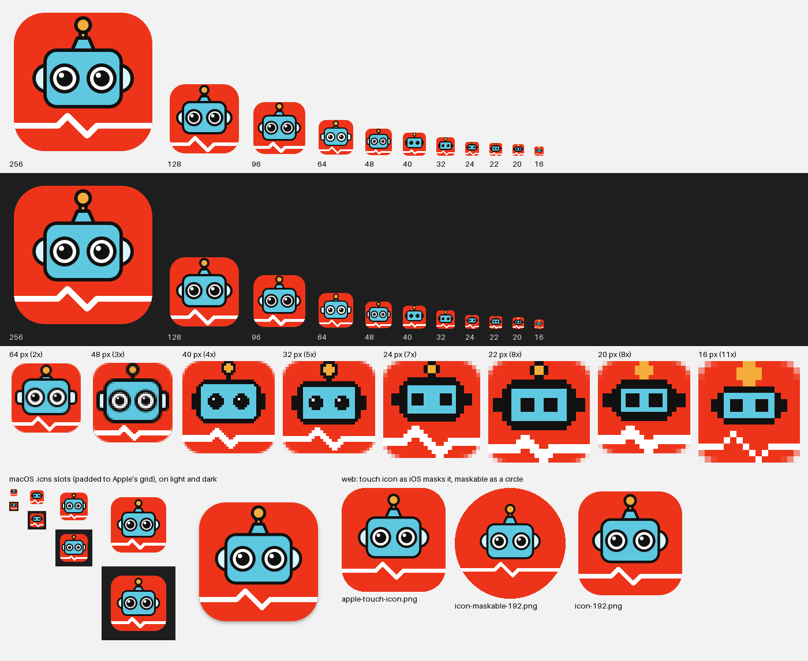
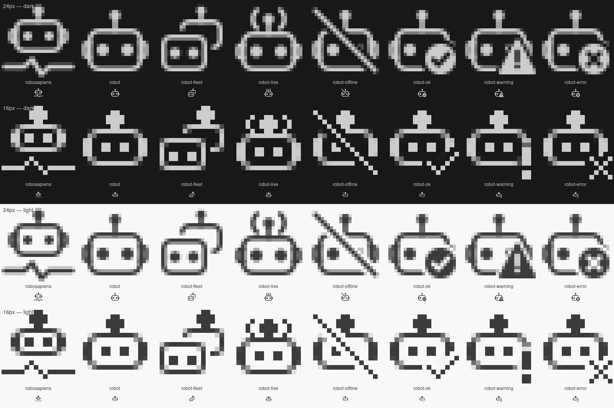

# Trustworthiness Checker Icons

App icons, platform icon files and monochrome glyphs for the RoboSAPIENS Trustworthiness Checker, a runtime verification framework for self-adaptive robotic systems.



Each size is drawn separately on its own pixel grid rather than scaled from one
master, so the small icons stay sharp and legible. See [Design](#design).

## Contents

| Folder | What it holds |
|---|---|
| `png/` | The app icon at 16, 20, 22, 24, 32, 40, 48, 64, 96, 128, 256, 512 and 1024 px |
| `svg/` | SVG sources: `robosapiens-monitor-master.svg` (scalable) and one file per PNG size; `svg/macos/` for the macOS variants |
| `windows/` | `robosapiens-monitor.ico` with 16, 20, 24, 32, 40, 48, 64, 128 and 256 px |
| `macos/` | `robosapiens-monitor.icns`, and its images as PNGs in `macos/png/` |
| `linux/` | `hicolor/`: a freedesktop icon-theme tree (16–512 px plus scalable SVG) |
| `web/` | `favicon.ico`, `apple-touch-icon.png`, PWA icons (`icon-*.png`, `icon-maskable-*.png`) and `site.webmanifest` |
| `vscode/` | Monochrome outline glyphs for VS Code (16 and 24 px) and an icon font |
| `tray/` | The glyphs as system-tray and macOS menu-bar icons |
| `scripts/` | The scripts that build and check everything in this folder |
| `preview.png`, `preview-glyphs.png` | Overview sheets of the app icons and the glyphs |

Colours: red `#ED341A`, cyan `#5EC8E0`, orange `#F4AD3B`, pale blue `#DAF5FB`,
outline `#111111`.

## Using the icons

### Windows

Use `windows/robosapiens-monitor.ico` as the application or installer icon. It includes
the 20 and 40 px sizes that Windows uses at 125% and 250% display scaling.

### macOS

Use `macos/robosapiens-monitor.icns` as the app bundle icon (`CFBundleIconFile`). It
follows Apple's icon grid: from 256 px up the tile fills 824/1024 of the canvas, with a
soft drop shadow, so the icon matches the size of other apps in the Dock. For an
Xcode asset catalog, use the PNGs in `macos/png/`. Each is named by its pixel size:
`-32.png` fills both "16pt @2x" and "32pt @1x", and `-64.png` fills "32pt @2x".

### Linux

Copy the icon theme tree and refer to the icon by name:

```sh
cp -r linux/hicolor ~/.local/share/icons/
gtk-update-icon-cache ~/.local/share/icons/hicolor   # if your desktop uses the cache
```

```ini
# in the application's .desktop file
Icon=robosapiens-monitor
```

### Web

Copy the files in `web/` to the site root and add to `<head>`:

```html
<link rel="icon" href="/favicon.ico" sizes="32x32">
<link rel="apple-touch-icon" href="/apple-touch-icon.png">
<link rel="manifest" href="/site.webmanifest">
```

`favicon.ico` holds sharp 16, 32 and 48 px drawings. The touch icon is a full square
because iOS rounds its corners itself. The maskable PWA icons keep the robot inside
the central safe circle, so any launcher mask shape leaves it whole.

### VS Code extension

**Extension icon.** Set `"icon": "png/robosapiens-monitor-256.png"` in `package.json`
(the Marketplace needs a PNG of at least 128 px).

**Glyphs.** `vscode/` holds eight monochrome glyphs. Each comes in two sizes, drawn
separately: `24/` for the Activity Bar and `16/` for commands, tree items and the status
bar.

| Glyph | Meaning | Font character | Icon id (in the snippet below) |
|---|---|---|---|
| `robosapiens` | Brand mark: head and pulse | `\E001` | `robosapiens-logo` |
| `robot` | A robot or monitored system | `\E002` | `robosapiens-robot` |
| `robot-fleet` | Several robots | `\E003` | `robosapiens-fleet` |
| `robot-live` | Connected or streaming | `\E004` | `robosapiens-live` |
| `robot-offline` | Disconnected | `\E005` | `robosapiens-offline` |
| `robot-ok` | Verdict: OK | `\E006` | `robosapiens-ok` |
| `robot-warning` | Verdict: warning | `\E007` | `robosapiens-warning` |
| `robot-error` | Verdict: error | `\E008` | `robosapiens-error` |



For generic concepts, use VS Code's built-in Codicons (`$(pulse)`, `$(graph-line)`, …).

The Activity Bar is the one place VS Code recolours an SVG itself, so use the
`currentColor` file there:

```jsonc
"viewsContainers": {
  "activitybar": [
    { "id": "robosapiens", "title": "RoboSAPIENS", "icon": "media/vscode/24/robosapiens.svg" }
  ]
}
```

Everywhere else, use the icon font `vscode/font/robosapiens-glyphs.woff`. Font icons
follow the theme colour and can be tinted, and at 16 px the font renders pixel for pixel
like the 16 px drawings:

```jsonc
"icons": {
  "robosapiens-logo":    { "description": "RoboSAPIENS",   "default": { "fontPath": "media/vscode/font/robosapiens-glyphs.woff", "fontCharacter": "\\E001" } },
  "robosapiens-robot":   { "description": "Robot",         "default": { "fontPath": "media/vscode/font/robosapiens-glyphs.woff", "fontCharacter": "\\E002" } },
  "robosapiens-fleet":   { "description": "Robot fleet",   "default": { "fontPath": "media/vscode/font/robosapiens-glyphs.woff", "fontCharacter": "\\E003" } },
  "robosapiens-live":    { "description": "Robot live",    "default": { "fontPath": "media/vscode/font/robosapiens-glyphs.woff", "fontCharacter": "\\E004" } },
  "robosapiens-offline": { "description": "Robot offline", "default": { "fontPath": "media/vscode/font/robosapiens-glyphs.woff", "fontCharacter": "\\E005" } },
  "robosapiens-ok":      { "description": "Robot OK",      "default": { "fontPath": "media/vscode/font/robosapiens-glyphs.woff", "fontCharacter": "\\E006" } },
  "robosapiens-warning": { "description": "Robot warning", "default": { "fontPath": "media/vscode/font/robosapiens-glyphs.woff", "fontCharacter": "\\E007" } },
  "robosapiens-error":   { "description": "Robot error",   "default": { "fontPath": "media/vscode/font/robosapiens-glyphs.woff", "fontCharacter": "\\E008" } }
}
```

Then write `$(robosapiens-ok)` in status-bar text and labels, set `"icon":
"$(robosapiens-live)"` on commands, or use
`new vscode.ThemeIcon("robosapiens-error", new vscode.ThemeColor("errorForeground"))`
for a tinted tree-item icon. (The paths assume this folder is copied to `media/`.)

If you'd rather use SVG files for commands or tree items, use the fixed-colour pairs in
`vscode/16/light/` and `vscode/16/dark/`. VS Code draws those exactly as they are, so
they can't use `currentColor`.

### System tray and menu bar

- **macOS menu bar:** `tray/macos/<glyph>Template.png` and `<glyph>Template@2x.png`.
  They're black on transparent, and the `Template` suffix tells macOS to recolour
  them for light and dark menu bars.
- **Windows and Linux trays:** `tray/white/` (for dark panels) and `tray/black/` (for
  light panels), each with `<glyph>-16/24/32/48.png`. The 32 and 48 px files are exact 2×
  versions of the 16 and 24 px drawings, for high-resolution screens.

## Design

- **Drawn per size.** The 256–1024 px icons come from the master. The 96 and 128 px
  sizes have heavier outlines and bigger pupils. The 48 and 64 px sizes have pale ear
  tabs and are drawn on the pixel grid. From 16 to 40 px the icons are pixel-drawn in a
  simpler style with solid dot eyes, like the glyphs. From 32 px up the eyes have a
  highlight at the upper left, as on the mascot.
- **Sharp at every size.** Outlines are whole pixels wide and sit on the pixel grid.
  The heartbeat line has the same shape at every size, with all diagonals at 45°. In
  every PNG it is drawn pixel by pixel, so it is never blurred. Only the scalable master
  SVG keeps a vector line.
- **Line weights** grow relatively heavier as icons get smaller:

  | Size | 1024 / 512 / 256 | 128 | 96 | 64 | 48 | 40 | 32 | 24 / 22 / 20 | 16 |
  |---|---|---|---|---|---|---|---|---|---|
  | Outline (px) | 24 / 12 / 6 | 4 | 3 | 2 | 2 | 2 | 2 | 2 | 1 |
  | Heartbeat line (px) | 40 / 20 / 10 | 6 | 5 | 3 | 3 | 3 | 2 | 2 | 1 |

## Rebuilding

All files except this README and the scripts are generated. To rebuild them:

```sh
python3 scripts/build.py
```

This needs Python 3 with Pillow and fontTools, plus Inkscape and ImageMagick
(`magick`). The build runs `scripts/check.py` and stops if anything is wrong. It
checks for:

- blurred heartbeat pixels, or a heartbeat line that touches the head;
- line widths that differ from the table above;
- `.ico` and `.icns` entries that don't match their PNGs;
- wrong macOS padding, or artwork outside a web icon's safe zone;
- an icon font that doesn't match the 16 px glyphs.

Then it redraws the preview sheets.

Per-size geometry lives in `scripts/build.py` (`TIERS`, `PULSE` and the `px12`–`px40`
drawings) and `scripts/build_glyphs.py` (the `G` table).

## Credits

Based on the RoboSAPIENS project logo and mascot.
